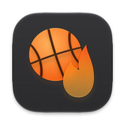
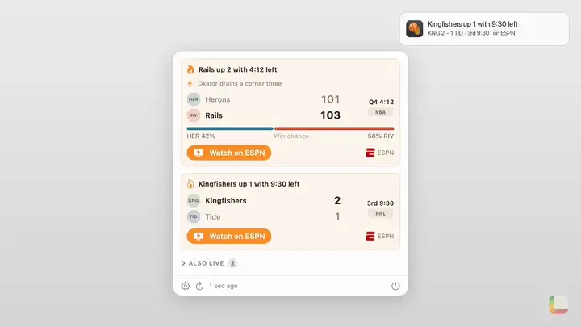

<p align="center"></p>

<h1 align="center">Buzzer Beater</h1>

<p align="center">A menu bar app that tells you when a live game gets close, wild or historic.</p>

<p align="center"><a href="https://lamp.dev/?repo=https://github.com/lampdotdev/buzzerbeater&amp;from=readme"></a></p>

<p align="center"><a href="#build-it-yourself">Build it yourself</a></p>

<p align="center"><a href=".github/showcase/reel.mp4"></a></p>

<p align="center"><a href=".github/showcase/reel.mp4">Watch it with sound</a></p>

## Make Buzzer Beater yours

Each opens Lamp with a copy of Buzzer Beater and that change, ready to send:

- [Add a scoreboard desktop widget](https://lamp.dev/?repo=https://github.com/lampdotdev/buzzerbeater&from=readme&ask=Add%20a%20scoreboard%20desktop%20widget)
- [Remind me before big games](https://lamp.dev/?repo=https://github.com/lampdotdev/buzzerbeater&from=readme&ask=Remind%20me%20before%20big%20games)
- [Make it about reality TV](https://lamp.dev/?repo=https://github.com/lampdotdev/buzzerbeater&from=readme&ask=Make%20it%20about%20reality%20TV)

## Open it in Lamp

[Lamp](https://lamp.dev) is a Mac app that builds apps from a description and changes them as you ask. [Open Buzzer Beater in Lamp](https://lamp.dev/?repo=https://github.com/lampdotdev/buzzerbeater&from=readme) for a copy of your own, to use and to change as you like, with the credits below kept. Or, in Lamp, choose File → Open from GitHub… and paste `https://github.com/lampdotdev/buzzerbeater`.

## Build it yourself

With Apple's Command Line Tools installed (`xcode-select --install`):

```sh
zsh build.sh
```

The AI inside the app, and anything it does with other apps or devices, goes through Lamp, so those need Lamp open on the same Mac.

## License

MIT. See [LICENSE](LICENSE).
